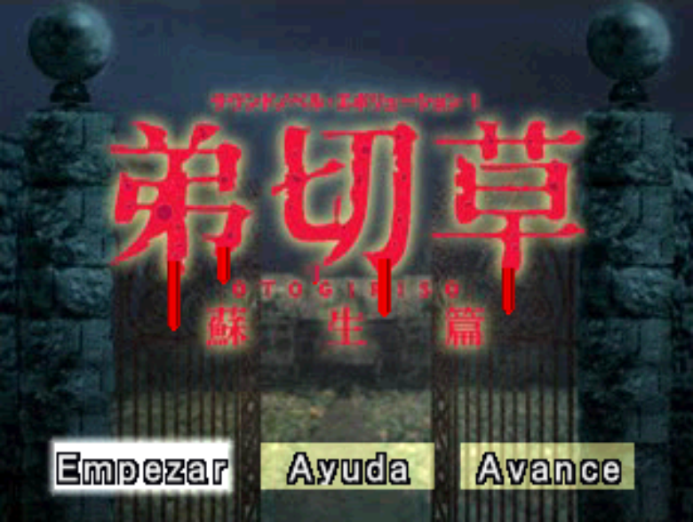
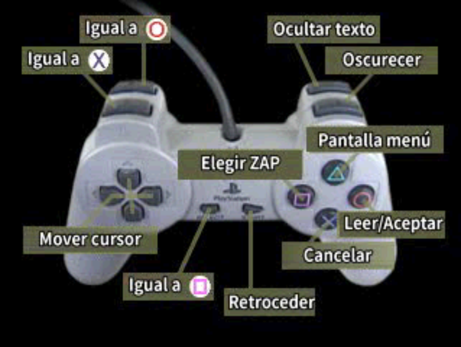
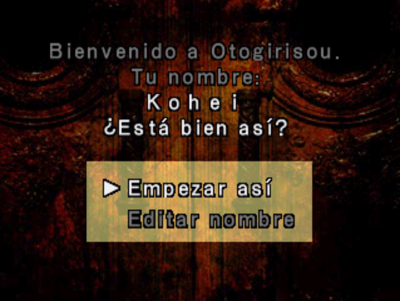
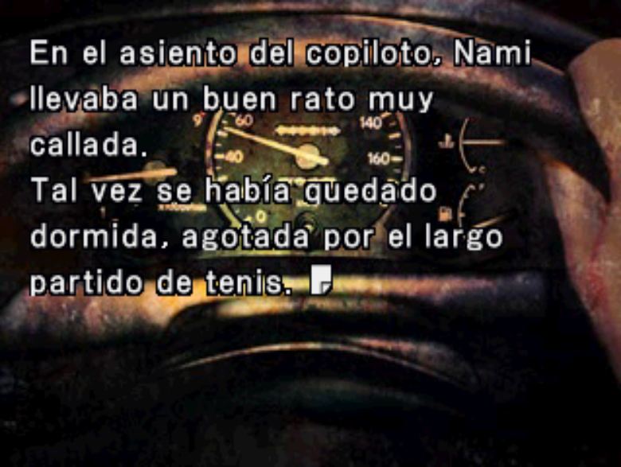
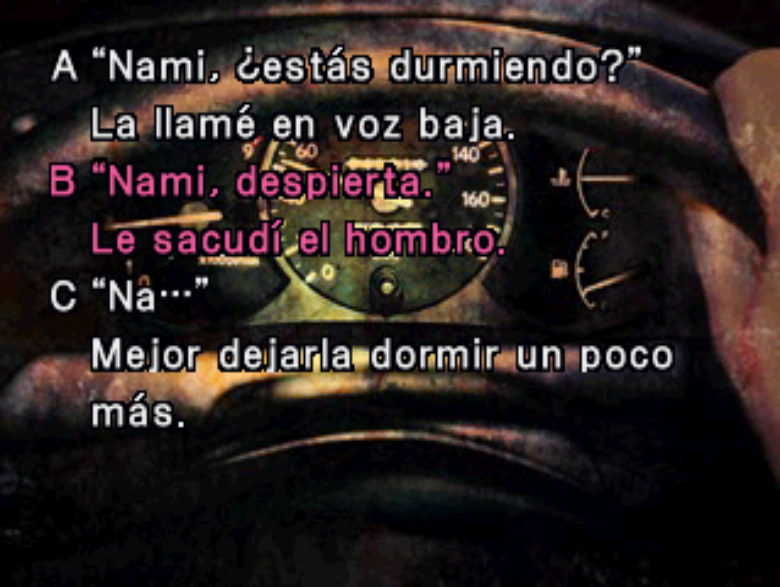
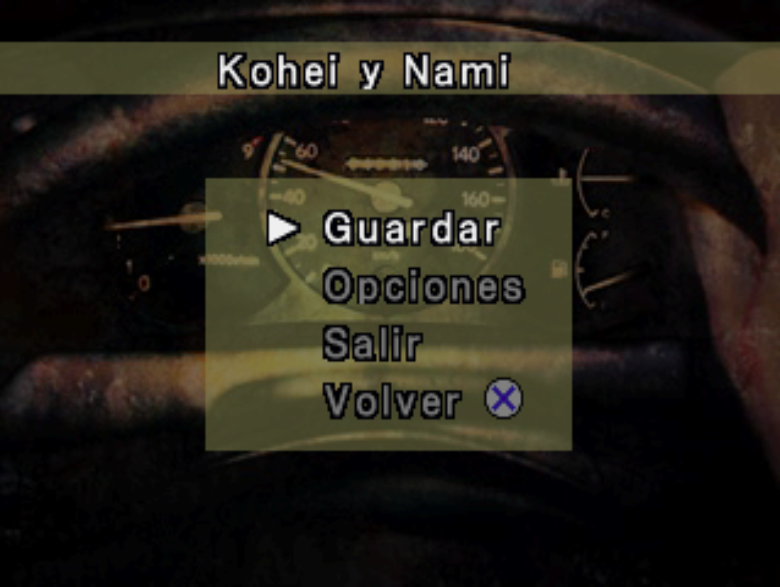

# Otogirisou – Sosei Hen (PSX) — Spanish Fan Translation

Fan translation into **Spanish** of *Otogirisou – Sosei Hen* (弟切草 蘇生篇, *Sound Novel Evolution 1*), the Sony PlayStation sound novel by Chunsoft. The whole script is translated, along with the menus, the save/copy/erase screens, the end-of-game screens and the controller image.

**Screenshots** (DuckStation)

<p>



</p>
<p>



</p>

> **Work in progress.** This repository does **not** contain the game. You need your own copy of the original disc image. Ready-made patches (xdelta) will be published in [Releases](../../releases) when the project is finished; until then, you can build the disc yourself (see below).

## Building the translated disc from source

1. **Get this repository** (`git clone https://github.com/Secabel/Otogirisou-Sosei-Hen.git`, or "Download ZIP" and extract it). It already includes the translation CSV, the tables and the generator scripts.
2. **Install the tools:**
   - [Python 3](https://www.python.org/downloads/)
   - Python packages: `pip install keystone-engine capstone numpy pillow`
3. **Copy your original disc image** to `rom/Sound Novel Evolution 1 - Otogirisou - Sosei-hen (Japan) (Rev 1).bin` (create the `rom` folder). It must match:

   | File | Size | CRC32 | SHA-1 |
   |---|---|---|---|
   | `Sound Novel Evolution 1 - Otogirisou - Sosei-hen (Japan) (Rev 1).bin` | 712,192,656 bytes | `4B915D81` | `30773aee2aab14a6c1bab92c01f88aa5779a876f` |

4. **Run, from the repository root:**

   ```
   python herramientas/generar_disco.py
   ```

   On Windows, if you get encoding errors, set `PYTHONUTF8=1` first (`set PYTHONUTF8=1`). The script extracts the game files it needs from your disc image, applies the translation and the code patches, and writes the result to `rom/es_completo/` (`.bin` + `.cue`). Open the `.cue` in your emulator. To change the output name, edit `NOMBRE` at the top of `generar_disco.py`.

The disc generation has been verified to be reproducible: building from a clean clone gives a byte-for-byte identical disc.

## Repository contents

| File / folder | What it is |
|---|---|
| `traduccion/traduccion_es.csv` | Spanish translation: source of truth (`;` separated, UTF-8 with BOM, columns `id;escena;japones;espanol`; `/` is a line break) |
| `traduccion/etiquetas_cortas.csv` | Shortened labels for menu options |
| `traduccion/mando_es.bin` | Controller image with the button names in Spanish (generated by `herramientas/mando_es.py`) |
| `tablas/mapa_ids_otogiri.json` | Map from the game's glyph ids to characters (used to write the translated text and the custom font) |
| `tablas/ops_cmd_v2.json` | Lengths of the script commands (used to parse and rebuild the script) |
| `herramientas/generar_disco.py` | **Entry point.** Builds the translated disc (settings at the top) |
| `herramientas/construir_disco.py` | Does the actual work: extracts, patches the executable and the script, writes the disc |
| `herramientas/parche_menus.py` | Code patches for the menus and the book/save screens (text layout, proportional spacing) |
| `herramientas/parche_nombre.py` | Player name patch |
| `herramientas/parche_mando.py`, `herramientas/mando_es.py` | Apply / generate the controller image |
| `herramientas/fuente_es.py`, `herramientas/mockup_latino.py`, `herramientas/atlas.py`, `herramientas/lzss_fuente.py` | Font: adds the Latin glyphs (accents, ñ, ¿ ¡) to the game's font |
| `herramientas/cargador_escenas.py`, `herramientas/reinsertar.py`, `herramientas/script_fmt.py`, `herramientas/extraer_unidades.py`, `herramientas/texto_es.py`, `herramientas/traducir.py`, `herramientas/etiquetas_cortas.py` | Script handling: parse, re-insert the translated text and shorten labels |
| `herramientas/notas.py`, `herramientas/parche_notas.py` | Translation notes: where to insert them in the script, and the code patch that draws them in lavender |
| `herramientas/disco.py`, `herramientas/mdec_psx.py` | PSX disc sector writing and MDEC image encoding |

Only what is needed to generate the disc is included here. The game files, disc images and emulator files are never committed (see `.gitignore`, which only allows the files listed above).

## Known issues

- **Not translated by design:** the "1回目" counter and the "終" mark on the book screen.
- The disc includes a demo of another game ("Machi"). Its menus are left untouched on purpose.
- Not every route has been re-tested after every change; some typos or inconsistencies may remain.

## Changelog

Build numbers (vNN) are internal disc versions used during development; only the important milestones are listed. Later build numbers only reflect rebuilds of the same content.

- **v69 (current):** 33 translation notes (the postponed-note mechanism was removed, so a note never shows up out of context), 17 wording fixes (e.g. "language of flowers" screens, "la rompimos", "Esta vez yo haré guardia…"), and the ZAPPING block (scene 33) now assumes every entry starts on a clean screen (fixes an odd 2-word split in "Fingí no saber nada…").
- **v68:** in-game translation notes: the first time a Japanese term appears in a scene (hitodama, bakeneko, yokai, tanuki, shochu, itadakimasu, tanabata, heian, ayu, seppuku, hannya, rakugo, tatami, sashimi, tonkatsu, Oiwa/Okiku, Kaguya, Suigyomatsu), a one-line note is shown under the text in lavender (`*Hitodama: llama flotante`). Notes only go on screens where the term is guaranteed to have been read (or on the next linear screen) and where a free row exists. Also: `(15 cm)` added to the *sun* measurement, the pop-up of the ZAPPING option no longer shows extra kanji and no longer leaves a stray line when returning to the story, and the wording of the "language of flowers" screens was fixed.
- **v65:** translation fixes (13 reviewed cases), player name no longer glued to the previous word, page state after a menu choice followed by a jump fixed (dirty screens), and menu questions no longer split into one-line screens (the question stays whole and the options go alone on a clean screen) and one-/two-word leftover screens mid-sentence removed (the 0x14 wait is now treated as a page break); also fixed text fragments joined without a space (19 words such as diary dates `julioEs`, `dispersascayeron`, `ahoraparecía`, plus ~110 places after punctuation such as `Nami...¡Nami!`).
- **v56–v58:** menu fixes (5-option menus fit within 9 rows), last wording corrections after a full playthrough.
- **v50–v57:** full quality review of the Spanish text against the Japanese (~210 corrections), short menu labels reviewed, menu options always capitalised, glossary unified.
- **v49:** critical fix: 9 scenes ended without a jump and fell into garbage (Japanese text and repeated scenes on screen). Script flow verified identical to the original.
- **v43–v48:** line-break fixes (premature breaks after merged fragments, hanging opening marks `“ ¿ ¡`, no break before names mid-sentence).
- **v40–v42:** visual review of 426 rare kanji (77 corrected), integer pixel advance on the book screens and the title, title recentred.
- **v30–v38:** end-of-game notice, controller image translated (own lossless MDEC encoder), book screens (header, copy, erase, "Sin usar") and save-slot screens working.
- **v12–v29:** memory-card and shared message screens, options and help frame, name confirmation, pause menu reimplemented (several graphical bugs after Options fixed).
- **First builds:** script extraction and re-insertion, Latin glyphs (accents, ñ, ¿ ¡) added to the font, proportional text layout.

## Credits

- Translation and ROM hacking: **Talion**.
- Tools: Python, [Keystone](https://www.keystone-engine.org/), [Capstone](https://www.capstone-engine.org/), [DuckStation](https://www.duckstation.org/) and [PCSX-Redux](https://github.com/grumpycoders/pcsx-redux) for testing.
- Part of the Spanish script is based on the English translation of the Super Famicom version by **ButThouMust** and **Guest** ([otogirisou-english](https://github.com/ButThouMust/otogirisou-english), GPL v3); the rest is new translation from the PlayStation Japanese text. Thanks to them for their work.
- The license will be defined at the first release (it must be compatible with GPL v3 because of the text above).

## Legal

This is an unofficial fan project, not affiliated with or endorsed by the original developers or publishers. *Otogirisou* and all related rights belong to their respective owners. No game data is distributed here: the patches will only contain the differences from the original disc image, which you must supply yourself.
