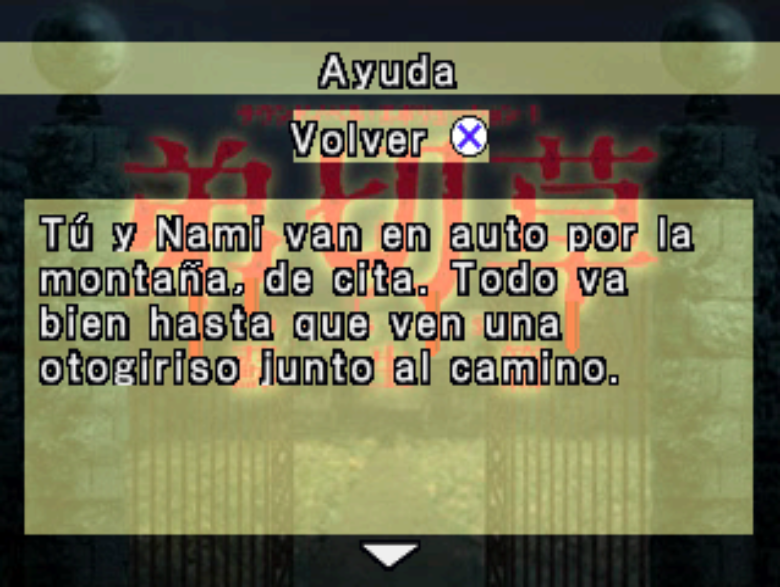
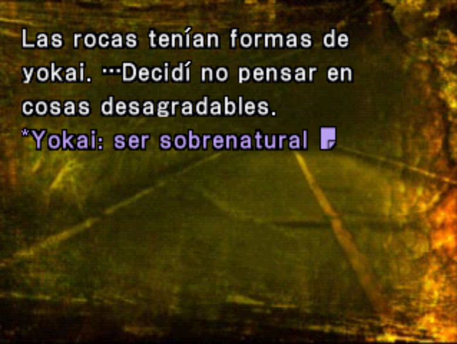
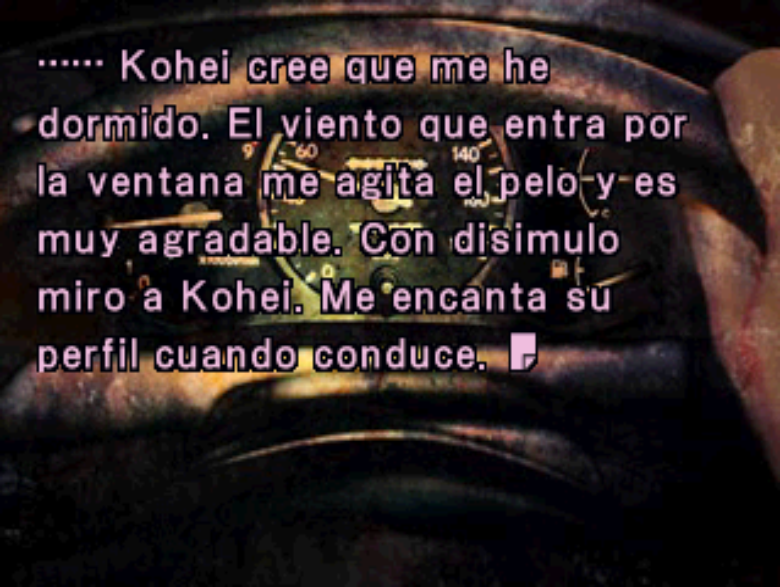
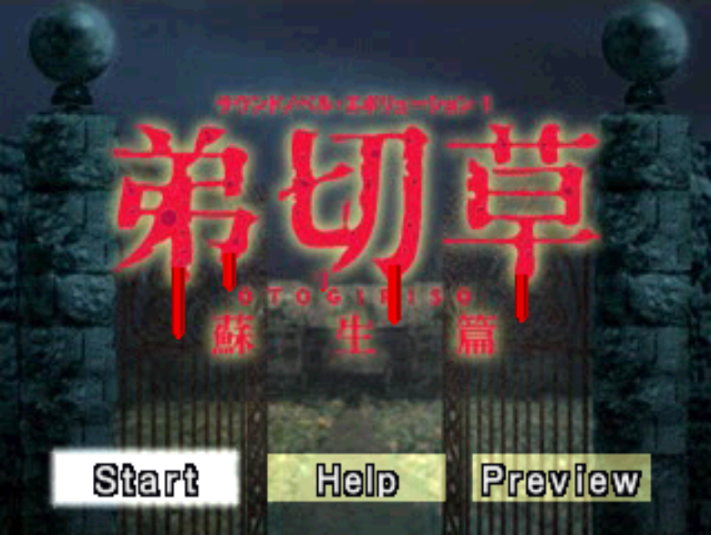
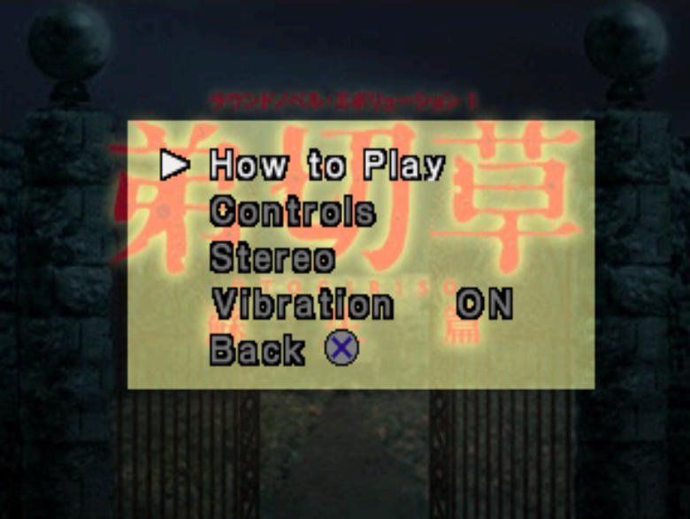
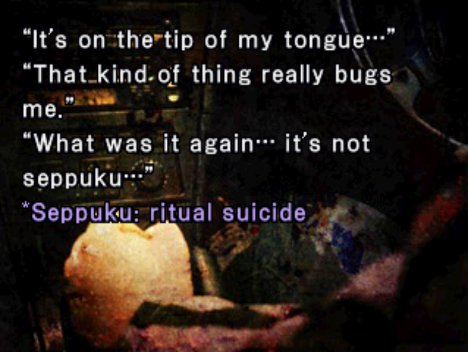

# Otogirisou – Sosei Hen (PSX) — Spanish & English Fan Translation

Fan translation into **Spanish** and **English** of *Otogirisou – Sosei Hen* (弟切草 蘇生篇, *Sound Novel Evolution 1*), the Sony PlayStation sound novel by Chunsoft. The whole script is translated, along with the menus, the save/copy/erase screens, the end-of-game screens and the controller image.

This repository holds **both patches**, built from the same engine tools:

| Patch | Language | Release asset | Source folders |
|---|---|---|---|
| Spanish | Español | `Otogirisou_ES_vNN.bps` | `herramientas/`, `traduccion/`, `tablas/` |
| English | English | `Otogirisou_EN_vNN.bps` | `english/` |

Both are published in the **same release** (currently **v1.8**). Download the `.bps` whose name starts with `Otogirisou_ES` (Spanish) or `Otogirisou_EN` (English).

**Screenshots** (DuckStation)

Spanish:

<p>


</p>
<p>


</p>
<p>



</p>

English:

<p>



</p>

> **This repository does not contain the game.** You need your own copy of the original disc image. The ready-made BPS patches (Spanish and English) are in [Releases](https://github.com/Secabel/Otogirisou-Sosei-Hen/releases) (apply it to your original disc image with Flips or any BPS patcher); you can also build the disc yourself from source (see below).

## Building the translated disc from source

Steps 1–3 are common to both languages; step 4 depends on the language.

1. **Get this repository** (`git clone https://github.com/Secabel/Otogirisou-Sosei-Hen.git`, or "Download ZIP" and extract it). It already includes the translation CSV, the tables and the generator scripts.
2. **Install the tools:**
   - [Python 3](https://www.python.org/downloads/)
   - Python packages: `pip install keystone-engine capstone numpy pillow`
3. **Copy your original disc image** to `rom/Sound Novel Evolution 1 - Otogirisou - Sosei-hen (Japan) (Rev 1).bin` (create the `rom` folder). It must match:

   | File | Size | CRC32 | SHA-1 |
   |---|---|---|---|
   | `Sound Novel Evolution 1 - Otogirisou - Sosei-hen (Japan) (Rev 1).bin` | 712,192,656 bytes | `4B915D81` | `30773aee2aab14a6c1bab92c01f88aa5779a876f` |

4. **Run the generator for your language.**

   **Spanish** — from the repository root:

   ```
   python herramientas/generar_disco.py
   ```

   On Windows, if you get encoding errors, set `PYTHONUTF8=1` first (`set PYTHONUTF8=1`). The script extracts the game files it needs from your disc image, applies the translation and the code patches, and writes the result to `rom/es_completo/` (`.bin` + `.cue`). Open the `.cue` in your emulator. To change the output name, edit `NOMBRE` at the top of `generar_disco.py`.

   **English** — from the `english` folder:

   ```
   cd english
   python tools/generate_disc.py
   ```

   Same requirements and the same original disc image (`../rom/...`). The result is written to `rom/en_completo/` (`.bin` + `.cue`). To change the output name, edit `NOMBRE` at the top of `generate_disc.py`.

The Spanish disc generation has been verified to be reproducible: building from a clean clone gives a byte-for-byte identical disc.

## Repository contents

### Spanish patch

| File / folder | What it is |
|---|---|
| `traduccion/traduccion_es.csv` | Spanish translation: source of truth (`;` separated, UTF-8 with BOM, columns `id;escena;japones;espanol`; `/` is a line break) |
| `traduccion/etiquetas_cortas.csv` | Shortened labels for menu options |
| `traduccion/mando_es.bin` | Controller image with the button names in Spanish (generated by `herramientas/mando_es.py`) |
| `tablas/mapa_ids_otogiri.json` | Map from the game's glyph ids to characters (used to write the translated text and the custom font) |
| `tablas/ops_cmd_v2.json` | Lengths of the script commands (used to parse and rebuild the script) |
| `herramientas/generar_disco.py` | **Entry point.** Builds the translated disc (settings at the top) |
| `herramientas/construir_disco.py` | Does the actual work: extracts, patches the executable and the script, writes the disc |
| `herramientas/parche_menus.py` | Code patches for the menus and the book/save screens (text layout, proportional spacing) |
| `herramientas/parche_nombre.py` | Player name patch |
| `herramientas/parche_mando.py`, `herramientas/mando_es.py` | Apply / generate the controller image |
| `herramientas/fuente_es.py`, `herramientas/mockup_latino.py`, `herramientas/atlas.py`, `herramientas/lzss_fuente.py` | Font: adds the Latin glyphs (accents, ñ, ¿ ¡) to the game's font |
| `herramientas/cargador_escenas.py`, `herramientas/reinsertar.py`, `herramientas/script_fmt.py`, `herramientas/extraer_unidades.py`, `herramientas/texto_es.py`, `herramientas/traducir.py`, `herramientas/etiquetas_cortas.py` | Script handling: parse, re-insert the translated text and shorten labels |
| `herramientas/notas.py`, `herramientas/parche_notas.py` | Translation notes: where to insert them in the script, and the code patch that draws them in lavender |
| `herramientas/disco.py`, `herramientas/mdec_psx.py` | PSX disc sector writing and MDEC image encoding |

### English patch (`english/`)

| File / folder | What it is |
|---|---|
| `english/translation/translation_en.csv` | English translation: source of truth (`;` separated, columns `id;escena;japones;japones_corregido;ingles`) |
| `english/translation/short_labels_en.csv` | Shortened labels for menu options |
| `english/translation/controller_en.bin` | Controller image with the button names in English |
| `english/translation/glossary_en.md`, `english/translation/translation_instructions_en.md` | Glossary and translation guidelines |
| `english/tables/*.json` | Glyph-id map, script command lengths and OCR/id corrections used to read the Japanese text |
| `english/tools/generate_disc.py` | **Entry point.** Builds the English disc (settings at the top) |
| `english/tools/build_disc.py` and the rest of `english/tools/*.py` | Same pipeline as the Spanish tools, with English names (`typeset.py` = text layout, `font_patch.py` = font, `patch_menus.py`, `patch_name.py`, `patch_controller.py`, `notes.py`/`notes_en.py`, `lang.py` = per-language settings, …) |

Only what is needed to generate the disc is included here. The game files, disc images and emulator files are never committed (see `.gitignore`, which only allows the files listed above).

## Known issues

- **Not translated by design:** the "1回目" counter and the "終" mark on the book screen.
- The disc includes a demo of another game ("Machi"). The demo itself is not translated; only its selector on the "Avance" screen ("Machi" / "Tráiler") is.
- Not every route has been re-tested after every change; some typos or inconsistencies may remain.

## Changelog

Build numbers (vNN) are internal disc versions used during development; only the important milestones are listed. The builds that were published as a patch are marked with their release number (v1.0, v1.1, …). Spanish and English have separate build numbers; since v1.5 both patches are published in the same release.

### English patch

- **EN v17 (release v1.8, `Otogirisou_EN_v17.bps`):** EN v15 plus one fix. **Disc end padding:** the patched disc now ends on a complete block of 16 sectors. Before, a PBP made from it (PSXPackager/PSX2PSP) made Beetle PSX stop on a black screen when the story started, because the first script scene lived in the last, incomplete block; the .cue/.bin was not affected. This also affects other converted images, so it is recommended to use this version if you convert the game to PBP; the PSP and Vita (POPS) have not been tested.
- **EN v15 (release v1.7, `Otogirisou_EN_v15.bps`):** v13 plus four fixes. **Leftover text after a choice:** the engine only clears 200 text sprites per screen and each letter, space and option of a menu uses one; 92 menus exceeded that (up to 257) and left the tail of the last option on the next screen. About 170 options were shortened so every menu fits. **Glued text:** a space is now added after “…” (and after commas) when the next sentence follows a short pause, and between the parts of a menu option (“race.On your marks”, “lipstick,that’d”, “bethe one”, “sit down?”inviting”). **Duplicate notes:** a term that already has its explanation in parentheses (“shochu (Japanese liquor)”) no longer also gets the in-game note. **Hearts:** the ♥ glyph now always has a space before it, in the story text and in menu options (it was glued to the last word in some places and spaced in others).
- **EN v13 (release v1.6, `Otogirisou_EN_v13.bps`):** v12 plus two layout fixes found in a Spanish playthrough that apply to the shared engine: an opening quote (“) is no longer left hanging at the end of the previous screen (247 lines re-flowed), and a new quotation that follows a closing quote or a sentence always starts on a new row.
- **EN v12 (release v1.5, `Otogirisou_EN_v12.bps`) — first English release:** full English translation of the PlayStation Japanese script, menus, save/copy/erase screens, end-of-game screens and controller image, with honorifics (-san/-kun/-chan) kept, 28 translation notes and shortened menu labels. Text layout is name-independent (it reserves the width of the widest 6-letter name) and includes the page-break rules around the player name from the Spanish v86 (a sentence is not cut right before the name; the cut falls at the end of a sentence or clause).

### Spanish patch

- **v90 (release v1.8, `Otogirisou_ES_v90.bps`):** v89 plus one fix. **Disc end padding:** the patched disc now ends on a complete block of 16 sectors. Before, a PBP made from it (PSXPackager/PSX2PSP) made Beetle PSX stop on a black screen when the story started, because the first script scene lived in the last, incomplete block; the .cue/.bin was not affected. This also affects other converted images, so it is recommended to use this version if you convert the game to PBP; the PSP and Vita (POPS) have not been tested.
- **v89 (release v1.7, `Otogirisou_ES_v89.bps`):** v87 plus four fixes. **Leftover text after a choice:** the engine only clears 200 text sprites per screen and each letter, space and option of a menu uses one; 12 menus exceeded that (e.g. the diary choice in scene 2 left “nos!”” on the next screen) and 13 options were shortened so every menu fits. **Glued text:** a space is now added after “…” followed by a short pause (“blanco…Es un vestido blanco.”), after commas (“me gusta,pero”) and between the parts of a menu option (“¡Suéltame!”Naomi”, “calma.“De”). **Hearts:** the ♥ glyph now always has a space before it, in the story text and in menu options (it was glued to the last word in some places and spaced in others).
- **v87 (release v1.6, `Otogirisou_ES_v87.bps`):** v86 plus fixes from a playthrough of the last chapter. **Layout (applied to every line):** a new quotation glued to the previous one or to a sentence (”“, …“) now starts on a new row (20 lines, e.g. “…alas de murciélago…“Sa… Salgamos.”), and an opening quote or “¡” is no longer moved back to the end of the previous screen (87 lines). **Text:** nine lines rewritten because they read unnaturally or were unclear (who is speaking about whom in the diary scene, “¿Se la habría llevado Naomi?”, the heart-massage line, the otogiriso box, the scar speech, among others).
- **v86 (release v1.5, `Otogirisou_ES_v86.bps`):** v85 plus fixes to page breaks around the player name found in a playthrough: a sentence is no longer cut right before the name (“…la letra de” | “Kohei.”, “…de cuando Kohei” | “y yo fuimos…”, “¿y si Kohei” | “había cambiado…”). The cut now falls at the end of a sentence or clause and the name travels with the rest of its phrase. About 10 spots (27 lines) are re-flowed; text is unchanged.
- **v85 (release v1.4, `Otogirisou_ES_v85.bps`):** v84 plus two menus whose question and options were one row too tall for the screen (scenes 4 and 17) shortened so they fit.
- **v84 (release v1.3, `Otogirisou_ES_v84.bps`):** v82 plus fixes from a full playthrough: a stray “ya” in one sentence was removed; a missing space before the player name was fixed in 12 places (e.g. “Kohei…Kohei”); 18 lines where the -san/-kun honorific after the player name had been omitted are restored; and the menu option “Jaja, me rindo, ¡qué ácido!” now shows the Japanese pun (rendirse/ácido) in Spanish.
- **v82 (release v1.2, `Otogirisou_ES_v82.bps`):** v81 plus the name-independent layout and page rules. **Text layout no longer depends on the player name:** the Spanish font is proportional, so a wide name (e.g. “Takumi”, “Mamoru”, “WWWWWW”) used to push some lines past the screen edge while “Kohei” fit. Lines and pages are now laid out reserving the width of the widest possible 6-letter name (96 px), so every name from “I” to “WWWWWW” displays correctly; the cost is a slightly shorter line wherever the name appears. About 960 of ~10,000 pages are re-flowed (text unchanged). Also: the pause menu title (“<name> y Nami”) is no longer truncated with a 6-letter name, and the new layout avoids one- or two-word leftover screens and stray punctuation at the start of a page.
- **v81:** v80 plus the pause-menu title fix for 6-letter names (draw limit 0x45 -> 0x46).
- **v80 (release v1.1, `Otogirisou_ES_v80.bps`):** v79 plus a fix for the ZAPPING freeze. **If you edited the player name with v1.0 (v79), the game could freeze when opening the ZAPPING box (and possibly Options or the pause menu); this release fixes it.** Details: a fix for that freeze (the code that limits the ZAPPING box overlapped a game variable that the name-entry screen overwrites; it now lives in memory owned by the patch) and the name screens (“Bienvenido a Otogiriso. / Tu nombre: / ¿Está bien así?”) now show all text in white, like the Japanese original.
- **v79 (release v1.0, first release, `Otogirisou_ES_v79.bps`):** v78 plus layout fixes found in a full playthrough: orphaned punctuation at the start of a page or row after the player name, a name split across rows (“Kohe” / “i”), single quotes glued together in the diary, and clearer wording on the Nami/Kohei choice screen.
- **v78:** v77 plus the Machi demo selector (“Machi” / “Tráiler”) translated.
- **v77:** v76 plus LOOP 9 fixes: missing space after “…” before a new sentence, stray closing quote at page start, lavender-tint chain on fades (nt B side effect), “hana” note moved to the pun page, name-screen “K” brightness, “fuerte e innumerables”.
- **v76:** v75 plus LOOP 8 fixes: name-link spacing, kitsunebi text and note, lavender note kept after the START reread (nt B), page cuts (mirror, wheelchair) and translation tweaks (placa, mirin note, nails in sun, fire/ruin pun note, otogiriso).
- **v75:** v74 plus 8 clarifying parentheses (teru teru bozu, mamushi, sansho, yakitori, Hinamatsuri, Yamata no Orochi, Ishinomori, Awa Odori), Meiji note, and the Yokaribe pun fix (12_0ac3).
- **v74:** LOOP 7 fixes: missing space between sentences when a lone "." was merged into the previous text ("mal.Nami"); screens no longer split a sentence between two pages when it did not fit (and ~55 pages that started with an empty row were fixed); 53 translation notes (was 35: menus no longer hide notes, notes repeat when a page can be reached without having seen the earlier one) plus new notes for "jitterbug" and the thunder-god/navel superstition; 9 translation corrections (Naomi's diary rhythm, "Nuestras voces temblaban", "Toyokawa Inari (santuario)", etc.).
- **v73:** LOOP 6 fixes: in choice screens the narration now continues on the same row as the quote (no forced line break after the closing quote); cursor pauses that fell in the middle of a phrase (e.g. "pero a ▶ Kohei") now sit where the original puts them (18 places); a few translation corrections ("tonta", "árbol", "su piel", "no eras tú", NHK explained, narrator fix in one scene) and 2 translation notes (Sashimi restored in short form, "hana" = flor/nariz).
- **v72:** v71 plus a wider safety margin for the 200-sprite text limit (checked on every scene with a page scanner: no page over 197 letters, maximum 196); 2 translation notes that did not fit the margin were dropped (Sashimi in scene 10, Shochu in scene 14) and 1 Hitodama note moved to another page of scene 13 (34 -> 32 notes). Also "shochu (licor japonés)" is explained in the text of 14_0442 instead of a note.
- **v71:** v70 plus the LOOP 5 "cleanup" fixes: no screen or menu may exceed the engine's 200 text sprites (stray text such as "scar a Nami." / "io." left on screen after a menu); 21 long menu labels shortened; the long page before "Nami se rio." is split earlier. (The v70 disc generated at 13:15 on 6 Oct did NOT include these.)
- **v70:** LOOP 5 fixes: numbers like "180.000" are no longer split across screens; the first row of some screens (e.g. "La sala de / calderas…") is no longer cut early (screen state is no longer inherited through the highlighted-name jumps, op 0x2d); one screen reworded so a sentence is not split ("Al mirar el manómetro…"). Also a missing space after a sentence when a pause command sits between two text pieces ("¿Eh?Se oía" → "¿Eh? Se oía"; 41 places). Also translation touch-ups from the LOOP 5 review (cubeta, 'dos de cada cosa', 'no hay a quién avisar', momia/armadura sentence, 'el pez de hace un momento', sandía, short labels), the game name is now written "Otogiriso" (as on the title screen) in all text and menus, and a translation note "*NT: es un refrán japonés" next to the proverb of 06_1caf. Menus whose letters exceed the engine's 200-sprite text area (stray text left after choosing, e.g. "scar a Nami.") are fixed: the question is moved to its own screen when needed and 21 long option labels were shortened.
- **v69:** 33 translation notes (the postponed-note mechanism was removed, so a note never shows up out of context), 17 wording fixes (e.g. "language of flowers" screens, "la rompimos", "Esta vez yo haré guardia…"), and the ZAPPING block (scene 33) now assumes every entry starts on a clean screen (fixes an odd 2-word split in "Fingí no saber nada…").
- **v68:** in-game translation notes: the first time a Japanese term appears in a scene (hitodama, bakeneko, yokai, tanuki, shochu, itadakimasu, tanabata, heian, ayu, seppuku, hannya, rakugo, tatami, sashimi, tonkatsu, Oiwa/Okiku, Kaguya, Suigyomatsu), a one-line note is shown under the text in lavender (`*Hitodama: llama flotante`). Notes only go on screens where the term is guaranteed to have been read (or on the next linear screen) and where a free row exists. Also: `(15 cm)` added to the *sun* measurement, the pop-up of the ZAPPING option no longer shows extra kanji and no longer leaves a stray line when returning to the story, and the wording of the "language of flowers" screens was fixed.
- **v65:** translation fixes (13 reviewed cases), player name no longer glued to the previous word, page state after a menu choice followed by a jump fixed (dirty screens), and menu questions no longer split into one-line screens (the question stays whole and the options go alone on a clean screen) and one-/two-word leftover screens mid-sentence removed (the 0x14 wait is now treated as a page break); also fixed text fragments joined without a space (19 words such as diary dates `julioEs`, `dispersascayeron`, `ahoraparecía`, plus ~110 places after punctuation such as `Nami...¡Nami!`).
- **v56–v58:** menu fixes (5-option menus fit within 9 rows), last wording corrections after a full playthrough.
- **v50–v57:** full quality review of the Spanish text against the Japanese (~210 corrections), short menu labels reviewed, menu options always capitalised, glossary unified.
- **v49:** critical fix: 9 scenes ended without a jump and fell into garbage (Japanese text and repeated scenes on screen). Script flow verified identical to the original.
- **v43–v48:** line-break fixes (premature breaks after merged fragments, hanging opening marks `“ ¿ ¡`, no break before names mid-sentence).
- **v40–v42:** visual review of 426 rare kanji (77 corrected), integer pixel advance on the book screens and the title, title recentred.
- **v30–v38:** end-of-game notice, controller image translated (own lossless MDEC encoder), book screens (header, copy, erase, "Sin usar") and save-slot screens working.
- **v12–v29:** memory-card and shared message screens, options and help frame, name confirmation, pause menu reimplemented (several graphical bugs after Options fixed).
- **First builds:** script extraction and re-insertion, Latin glyphs (accents, ñ, ¿ ¡) added to the font, proportional text layout.

## Credits

- Translation and ROM hacking: **Talion**.
- English version: the translation is made from the PlayStation Japanese text; the English Super Famicom translation by ButThouMust and Guest was only used as a reference for names and terms.
- Tools: Python, [Keystone](https://www.keystone-engine.org/), [Capstone](https://www.capstone-engine.org/), [DuckStation](https://www.duckstation.org/) and [PCSX-Redux](https://github.com/grumpycoders/pcsx-redux) for testing.
- Part of the Spanish script is based on the English translation of the Super Famicom version by **ButThouMust** and **Guest** ([otogirisou-english](https://github.com/ButThouMust/otogirisou-english), GPL v3); the rest is new translation from the PlayStation Japanese text. Thanks to them for their work.
- License: [GNU GPL v3](LICENSE), as required by the GPL v3 text above.

## Legal

This is an unofficial fan project, not affiliated with or endorsed by the original developers or publishers. *Otogirisou* and all related rights belong to their respective owners. No game data is distributed here: the patches will only contain the differences from the original disc image, which you must supply yourself.
